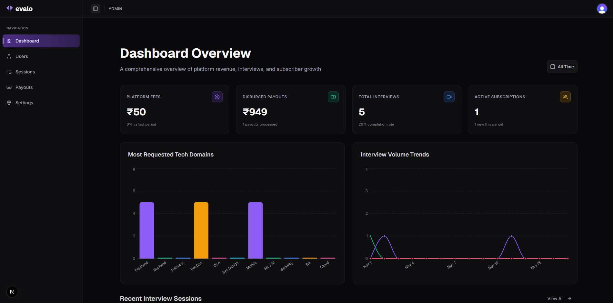

<!-- TODO: Add banner image -->

# Evalo Admin

Evalo Admin is an internal operations dashboard for managing mock technical interview sessions, interviewer payouts, user accounts, and platform configurations.

## Overview

Peer-to-peer interview platforms require strict session auditing and fraud controls that customer-facing applications cannot expose. Evalo Admin centralizes call verification, automated financial disbursements, and role governance into an administrative portal.

## Key Features

- Audits live video sessions by inspecting Stream call presence data, duration logs, and recordings to resolve dispute claims and process credit refunds.
- Processes interviewer payouts through Cashfree Cashgram with instant payout link generation, approval workflows, and transaction state tracking.
- Moderates platform accounts by inspecting user metadata, revoking active Clerk sessions, toggling access status, and exporting records to CSV.
- Visualizes platform activity trends, domain expertise distribution, and operational metrics using Recharts.
- Configures global platform fee percentages, credit conversion rates, and minimum withdrawal limits.

## Tech Stack

| Category | Technology |
|---|---|
| Language | TypeScript |
| Framework | Next.js (App Router, React 19) |
| UI & Styling | Tailwind CSS, shadcn/ui (Base UI), TanStack Table, Lucide Icon |
| Database & ORM | PostgreSQL, Prisma ORM |
| Authentication | Clerk (Role-Based Access Control) |
| Major Services | Stream Video SDK, Cashfree Cashgram API |

## Deployment

- Multi-stage Docker container utilizing Next.js standalone output for minimal image footprint.
- GitHub Actions CI workflow running lint checks, Prisma client generation, static type verification, and build validation on pull requests targeting main, staging, and production branches.
- Staging deployment building and publishing Docker container images to GitHub Packages (GHCR) and triggering updates via Render deploy hooks on pushes to staging branch.
- Production deployment hosted on Vercel with automated deployments triggered on pushes to production branch.

## License

Copyright (c) 2026 Samim Middey. All rights reserved.

This source code is provided for viewing and evaluation purposes only.
No permission is granted to copy, modify, distribute, or use it
without prior written permission from the copyright holder.
